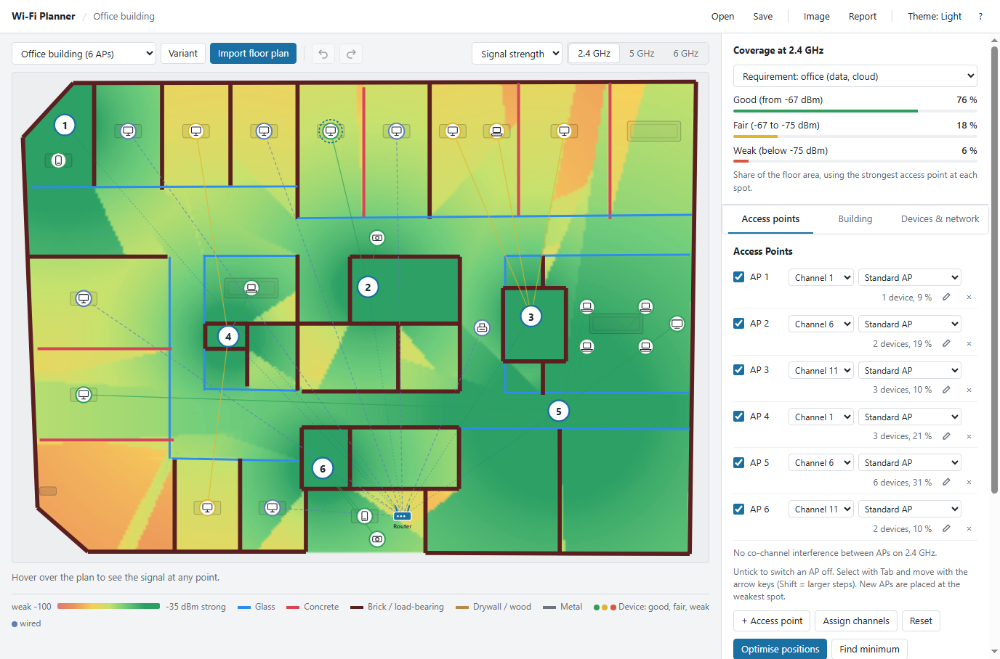

# Wi-Fi Planner

A small browser tool for planning Wi-Fi in a building. You load a floor plan, place access points
and devices, and it shows a heat map of the expected signal, how well each spot is covered and
roughly what speed each device would get.

It is a single static page. No build step, no server, no account, and the floor plan you import
stays in your browser.



## What it does

- Heat maps for signal strength, serving AP, SINR, data rate and number of APs in range, for 2.4, 5 and 6 GHz
- Floor plan import from PNG/JPG: walls, outline and balconies are detected, and the building width is read
  from the dimensions on the drawing (OCR) if there are any
- Walls in five materials (glass, concrete, brick, drywall, metal) with editable losses; walls can be drawn,
  changed or deleted by hand
- AP models (router, ceiling AP, Wi-Fi 6E/7, mesh, outdoor), channel planning and an optimiser that suggests
  positions or the minimum number of APs
- Devices with a simulated speed test, neighbouring networks and microwaves as interferers
- Several floors per building, variants for comparing layouts
- Calibration from a few real measurements taken with a phone app
- Report for printing or PDF, map export as PNG, projects saved as JSON

## Getting started

Download or clone the repository and open `index.html` in a current browser (Chrome, Edge, Firefox).
That is all.

To try it, pick one of the example buildings at the top left, or click **Import floor plan** and drop in
a plan of your own. If the width shown after the import is wrong, use **Measure scale** in the Building
tab and click a distance you know.

The OCR library (tesseract.js) is fetched from jsDelivr the first time a plan is imported. Everything
else works offline.

## How the numbers are calculated

The model is the usual textbook chain, kept simple enough to recalculate while you drag things around:

1. **Path loss**: free-space loss at 1 m from frequency and the speed of light, then the multi-wall model
   `L = L0 + 10 n log10(d) + sum(k_i * L_i)`, where every wall crossed by the straight line adds its loss.
2. **Received power**: `P_rx = P_tx + G_tx - L + G_rx`, with a receive gain per device type.
3. **SINR**: received power over thermal noise (`-174 dBm/Hz + 10 log10(B) + noise figure`) plus every
   other AP, neighbouring network or microwave on the same channel.
4. **Rate**: Shannon capacity `C = B log2(1 + SINR)` per spatial stream, capped at the Wi-Fi 6 maximum.
   Pure Shannon is optimistic at low SINR; the "Gap to Shannon limit" slider takes that into account.
5. **Airtime**: devices whose APs share a channel and hear each other are run through a small CSMA/CA
   simulation (random backoff, contention window doubling on collisions, frame aggregation). The speed
   test result comes from that.

All formulas are listed with the current values under *Building > Radio model > Model formulas*.

## Limitations

- It is an estimate, not a site survey. Measure a few spots before buying hardware.
- Only straight horizontal and vertical walls are detected; diagonal walls have to be drawn by hand.
- Detection works best on clean architectural drawings. Busy plans with lots of furniture or hatching
  can produce stray walls that need cleaning up.
- Floors are assumed to be aligned and at the same scale, and walls of other floors are ignored.
- Reflections are only covered through the path loss exponent, not modelled as such.

## Development

```
npm test        # or: node tests/test.js
npm run format  # prettier
```

The code is plain JavaScript without dependencies:

- `js/physics.js`: propagation, noise, SINR, Shannon and the CSMA/CA simulation
- `js/detection.js`: wall, outline and dimension detection on the raster image
- `js/app.js`: everything on the page

The first two run in Node as well, which is what the tests use.

## License

MIT, see [LICENSE](LICENSE). tesseract.js is Apache-2.0 and is loaded from its CDN, not bundled.
